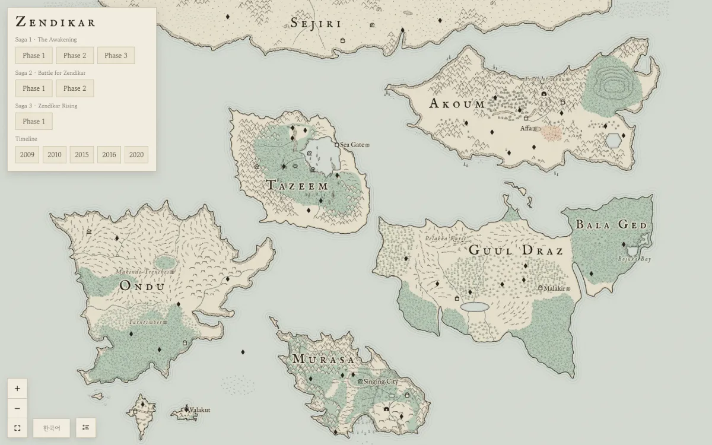
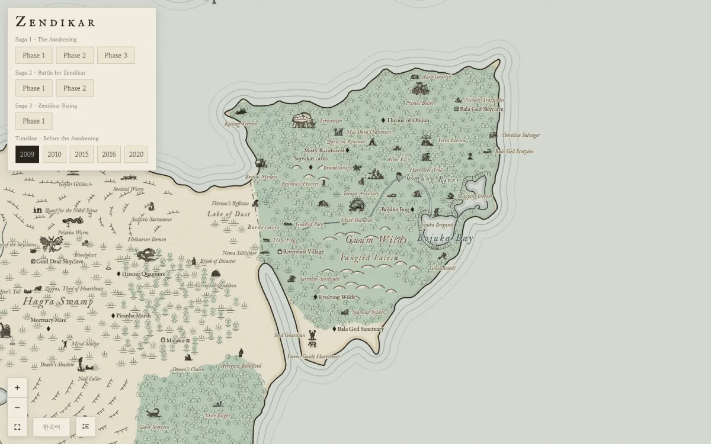
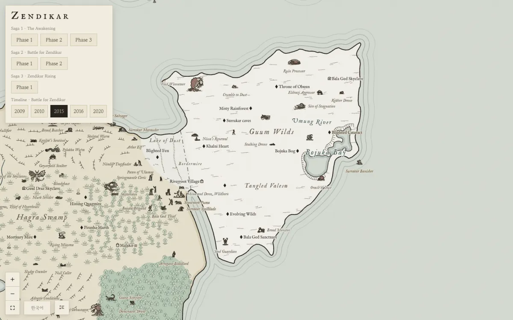
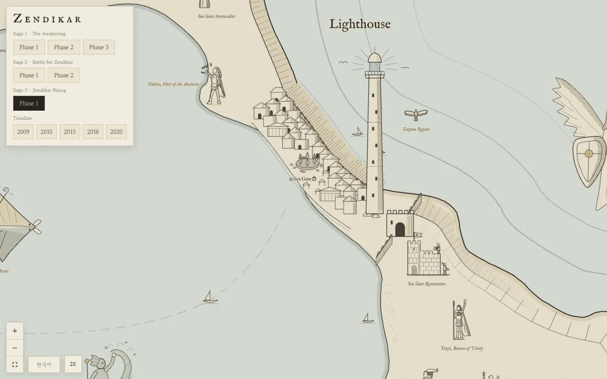

# Zendikar Map

An interactive, lore-sourced map of **Zendikar**, the plane of adventure from *Magic: The Gathering*.

**Live site:** https://zendikar-map.vercel.app



Zendikar never got an official world map. This project builds the closest thing it can from the official sources (cards, Magic Story articles on magic.wizards.com, Plane Shift): every non-basic card from ZEN, WWK, ROE, BFZ, OGW and ZNR is placed where the lore puts it, and the land itself changes as the story moves from 2009 to 2020.

## What you can do

- **Zoom deep.** The map goes to 256×. At high zoom, regions open into separately drawn detail maps holding the smaller subjects: people, camps, creatures.
- **Browse by saga.** The header has three sagas: *The Awakening* (ZEN, WWK, ROE), *Battle for Zendikar* (BFZ, OGW) and *Zendikar Rising* (ZNR). Each set is a phase. Turning one on draws that set's cards on the map as subjects in the map's own style, not as card images.
- **Scrub the timeline.** The 2009, 2010, 2015, 2016 and 2020 buttons show the plane as it was at each point. Bala Ged turns to white dust, Halimar drains, the Sea Gate falls and is rebuilt, and the skyclaves rise.
- **Read the sources.** Click any place, card or subject to open a panel with its description, history and citations.
- **Share a view.** The URL keeps your selection and view (see [URLs](#urls)).

| 2009 · Before the Awakening | 2015 · Battle for Zendikar |
| --- | --- |
|  |  |



## How placement works

- Names, continents and descriptions come only from official material. Names from the fan map below are used only where they agree with the lore.
- A location is drawn only with a reason:
  - **fan-map**: the fan map's position, kept because it doesn't contradict the lore.
  - **canon-hint**: an official description of where it is (the basis is cited).
  - **estimate**: the lore only gives a continent, terrain or neighbours, so the map picks a spot that fits and says why. Estimates are labelled *estimate* in the panel and look like every other marker on the map.
- Terrain (rivers, volcanoes, waterfalls, cliffs, forests, swamps, crystal fields, ice) follows the same rule: drawn when a source mentions it, and marked as an estimate when the map had to choose its course or extent.
- The default map shows Zendikar after *Zendikar Rising* (2020). Earlier states live in the timeline and phase views, and only where a source says a place looked visibly different at that time.

The continent layout is itself a reading of the lore. The reasoning is in [`docs/lore.md`](docs/lore.md).

## Language

Place names are in English by default. **Panel text (descriptions, history, notes on estimates) and the project docs are currently in Korean.** An English translation is planned.

The **한국어** button switches place names to the official Korean card printings. Korean names appear only where a Korean printing exists: ZEN, WWK and ROE (2009–10) had no Korean release.

## URLs

| Parameter | Effect |
| --- | --- |
| `#<place-id>`, `#continent/<id>`, `#card/<card-id>` | Open that panel |
| `?view=x,y,k` | Centre the map on (x, y) at zoom k (map units are 2400 × 1700) |
| `?saga=1&phase=1` … `?saga=3&phase=1` | A saga and its phase |
| `?time=1` … `?time=5` | Timeline: 2009, 2010, 2015, 2016, 2020 |
| `?lang=ko` | Korean place names |

## Development

Requires Node.js and [pnpm](https://pnpm.io).

```bash
pnpm install
pnpm dev      # dev server
pnpm build    # type-check + production build into dist/
pnpm lint     # oxlint
```

Stack: Vite, React 19, TypeScript, SVG with d3-zoom. Fonts: IM Fell English and Gowun Batang via @fontsource.

### Layout

- `src/data/`: places, continents, land cards (`cards.ts`), per-phase cards (`phase1.ts`–`phase6.ts`), timeline logic (`timeline.ts`), landscape and period-state data (`landscape/`, `periods/`)
- `src/map/`: the renderer (coastlines, terrain glyphs, labels, figures, deep-zoom detail maps)
- `src/components/`: search, place panel, controls, legend
- `scripts/figures/`, `scripts/childmaps/`: sources and generators for the drawn subjects and regional detail maps (style guides in each `STYLE.md`)
- `scripts/geo/`: coastline, forest and inland-sea extraction from the fan map (Python, OpenCV)
- `scripts/qa/`, `scripts/perf/`: screenshot, regression and performance tools
- `docs/`: research notes on the lore, landscape and asset sources (Korean)

[`CLAUDE.md`](CLAUDE.md) holds the full project rules (Korean).

### Deployment

The repo is connected to Vercel. Pushing to `main` deploys the live site, and other branches get preview URLs.

## Credits

- **Coastlines** are traced from **u/maussius**'s hand-drawn [*Planar map of Zendikar*](https://www.reddit.com/r/mtgvorthos/comments/168gf6r/planar_map_of_zendikar/) (r/mtgvorthos, 2023), which was based on *The Art of Zendikar*. The continents were then rearranged and rescaled to fit the lore. The original images are not included in this repo; to rerun the extraction in `scripts/geo/`, save them from that post into `asset/` (file names in [`docs/reference.md`](docs/reference.md)).
- **Card images and data** are from [Scryfall](https://scryfall.com).
- Terrain-generation ideas were studied from [Azgaar's Fantasy Map Generator](https://github.com/Azgaar/Fantasy-Map-Generator) and [mewo2/terrain](https://github.com/mewo2/terrain). They are reference only and are not included or imported (`pnpm refs` downloads them).
- Built with a lot of help from [Claude Code](https://claude.com/claude-code): the code and the map drawings. The lore research and every placement call were checked against the sources.

Zendikar Map is unofficial Fan Content permitted under the [Fan Content Policy](https://company.wizards.com/en/legal/fancontentpolicy). Not approved/endorsed by Wizards. Portions of the materials used are property of Wizards of the Coast. ©Wizards of the Coast LLC.
